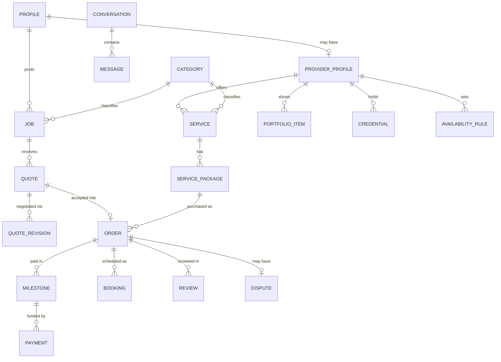
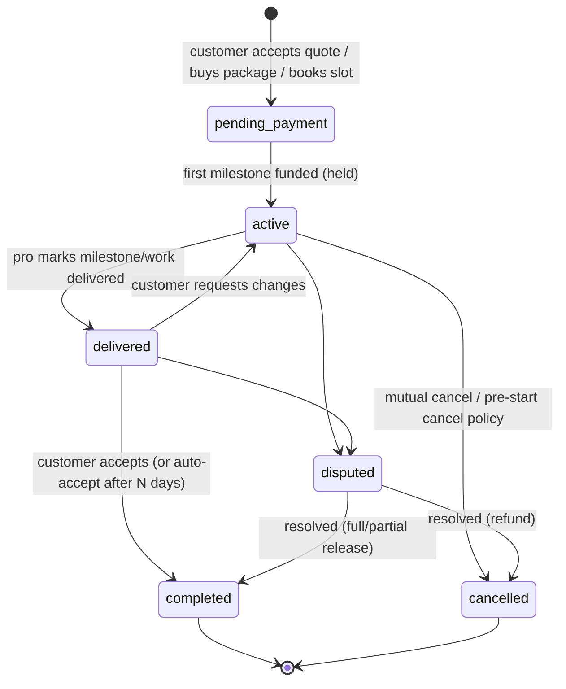
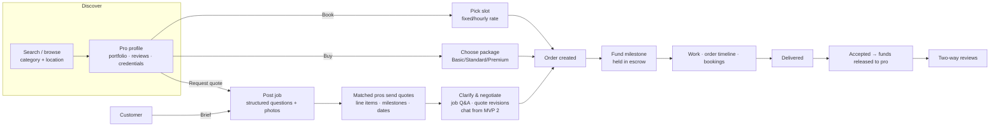
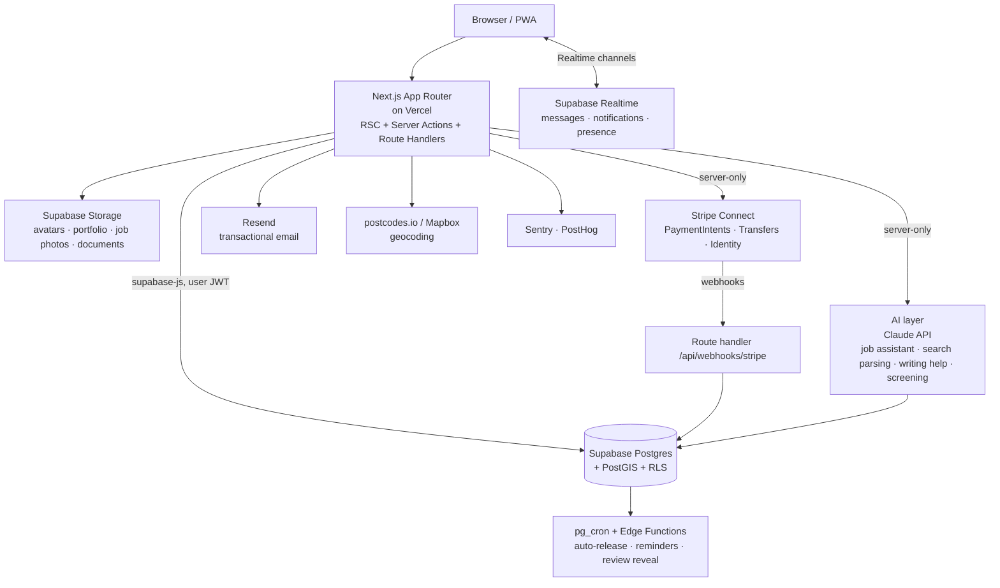

# Product & Technical Blueprint

> **Working name:** _Marketplace_ (placeholder — branding to follow; the folder codename is Collabriq)
> **Status:** Draft v0.4 for review · 3 Nov 2026
> **Decisions so far:** Blueprint first, then MVP · Next.js + Supabase · Solo build with Claude · MVP = core hiring loop **plus AI assistance**, released in two steps: **MVP 1 (launch) without real-time messaging**, **MVP 2 adds messaging** · On-site launch in **Doncaster, Sheffield and Manchester**, remote work UK-wide · **Commission-only** fees · Launch categories span trades, home services, creative & digital, artisans & events, hair & beauty, and van hire

---

## 1. One-line positioning

**One place to hire anyone skilled — from a logo to a loft conversion — with the trust, structure and payment protection that today only exists for one end of that range.**

Existing platforms split the world in two: _digital freelance_ (Upwork, Fiverr, PeoplePerHour) and _local trades & tasks_ (MyBuilder, Taskrabbit, Airtasker). Real customers don't live in that split. A café owner re-opening needs a shopfitter, an electrician, a signwriter, a photographer and a web designer — today that's four apps, four accounts, four payment models and no shared reputation. We unify those under one account, one trust layer and one payment system.

---

## 2. Competitive landscape

What each reference platform does well, where it falls short, and what we take from it. (Fee figures change often — verify current numbers before using them in any external material.)

| Platform | What it does well | Where it falls short | What we take / fix |
|---|---|---|---|
| **Upwork** | Proposals, contracts, milestones, hourly tracking, escrow; strong for long engagements | Pros pay to bid ("Connects") → race to the bottom; noisy proposal floods for clients; digital-only; heavy, dated UX for small jobs | Milestone escrow & contracts — but **no pay-to-quote**, and capped/ranked quotes per job |
| **Fiverr** | Productised "gigs" with tiered packages; buy in a few clicks; great for small, well-defined work | High seller commission; poor for custom-scoped work; little local/physical service coverage; reputation hard to carry | **Service packages** as one of three hiring modes, alongside custom quotes |
| **PeoplePerHour** | UK-centric; "Hourlies" (fixed-price offers) + job posting combined | Smaller supply; dated UX; limited trust signals | Proof that hybrid (listings + jobs) works in the UK |
| **Taskrabbit** | Instant booking of a vetted person at an hourly rate; availability-driven | Narrow category set; limited city coverage; not for projects or creative work | **Instant booking** against real availability |
| **MyBuilder** | UK trades focus; feedback-led reputation; customers post jobs free | Trades pay per lead/shortlist regardless of winning; no on-platform payment or protection; no creative work | Trade-specific trust (credentials, insurance) — but **pros only pay when they earn** |
| **Airtasker** | Post a task → receive offers fast; broad everyday categories; in-app payment | Price-driven bidding; weak for large or multi-stage jobs; thin professional profiles | Fast job → quotes flow, but with structured quotes and richer profiles |

### The gap we target

1. **One marketplace, three hiring modes** — no competitor offers all three well, across creative _and_ trade categories:
   - **Book** — pick a pro and a time slot at a fixed or hourly rate (Taskrabbit-style).
   - **Buy** — purchase a productised service package (Fiverr-style).
   - **Brief** — post a job, receive structured quotes, negotiate, hire, pay by milestone (Upwork/MyBuilder-style).
2. **A trust layer that fits the work** — identity verification for everyone, plus category-specific credentials (Gas Safe, NICEIC/NAPIT, CSCS, public-liability insurance, DBS for work in homes/with children) and portfolio evidence for creatives.
3. **Payment protection at every size** — funds held until work is accepted, from a £40 flat-pack job to a £40k extension paid in stages.
4. **Fair economics for pros** — no paying for leads or bids; we earn a commission when they earn.
5. **AI built in from day one** — an AI job assistant turns "my boiler's making a noise" into a structured job with the right category, questions answered, photos attached and a realistic price range; customers can search in plain English; pros get help writing profiles and quotes. Better briefs → better quotes → fewer wasted site visits. (In the MVP — see §6.)
6. **Pros as businesses** — CRM-lite for providers: pipeline, quotes, invoices, calendar, repeat clients, earnings reports. Gives pros a reason to run their business here, which reduces off-platform leakage.

---

## 3. Users

| Persona | Needs | Key jobs on the platform |
|---|---|---|
| **Household customer** (e.g. homeowner, tenant) | Trustworthy local help, fair price, protection if it goes wrong | Post a job, compare quotes, book a handyman, pay safely, review |
| **Small business customer** (café, agency, landlord) | Mix of creative + trade + ongoing help; invoices for accounts | Hire across categories, repeat-hire, team access, VAT invoices |
| **Creative / digital pro** (designer, photographer, videographer, developer) | Showcase portfolio, sell packages, win bigger briefs, get paid reliably | Portfolio, service packages, quotes, milestones, remote delivery |
| **Tradesperson / artisan** (electrician, plumber, carpenter, joiner, potter) | Local leads without paying per lead, prove credentials, manage diary | Credentials, service area, availability, site-visit quotes, staged payment |
| **Everyday task-doer** (handyman, cleaner, mover, assembler, man-with-a-van) | Steady small jobs, quick booking, simple pricing | Hourly rate, availability calendar, instant booking |
| **Hair & beauty pro** (mobile or salon/chair-based stylist, barber, makeup artist) | Fill the diary, cut no-shows, show their work | Service menu with durations, slot booking at their premises or the customer's, deposits, portfolio of looks |
| **Platform admin / ops** | Keep the marketplace safe and healthy | Verify pros, moderate, resolve disputes, manage categories, view metrics, issue refunds |

A single account can be both a customer and a provider (common for creatives and trades who also hire).

---

## 4. Core domain model



**The central idea: every hiring mode ends in an `Order`.** Book, Buy and Brief are just different front doors; once a customer commits, everything — scheduling, milestones, escrow, messaging, completion, reviews, disputes — runs through one `Order` lifecycle. That keeps the system coherent and lets reputation accrue across all work types.

### Order lifecycle



### Category taxonomy (initial)

Two levels (Category → Subcategory), each subcategory tagged with: **delivery mode** (at the customer's location / at the pro's premises / remote — any combination), **default hiring modes**, **required/optional credentials**, and **structured job questions** (e.g. Plumbing → "Is there an active leak?", "Property type?").

All groups below are in the launch set; the ★ subcategories get the most attention in supply recruitment and marketing (see §11).

- **Building & Trades** — ★electrician, ★plumber, gas engineer, carpenter/joiner, plasterer, roofer, builder, tiler, ★painter & decorator
- **Home Services** — ★handyman, ★house cleaning, end-of-tenancy cleaning, furniture assembly, removals, gardening, appliance repair
- **Hair & Beauty** — ★hair stylist (mobile or salon), barber, makeup artist, nails, bridal hair & makeup
- **Hire & Transport** — ★van & driver (man-with-a-van), small removals, waste/tip runs; self-drive van rental (see note)
- **Creative & Design** — ★graphic design, branding, illustration, ★photography, videography, animation, music & audio
- **Digital & Tech** — ★web design, development, marketing, copywriting, IT support
- **Artisans & Makers** — bespoke furniture, ceramics, signwriting, upholstery, metalwork
- **Events & Lifestyle** — DJs, caterers, event styling, tutors, personal trainers

> **Note on van rental.** _Van & driver_ is a service and fits the normal Order flow. _Self-drive van rental_ is renting out an asset, which works differently: driving-licence checks (DVLA), hire insurance that covers the renter, damage deposits, vehicle hand-over checks and mileage limits. Recommendation: launch with van & driver in the MVP, and add self-drive rental in Phase 2 as a separate **Rental** hiring mode once an insurance partner is in place.

Hair & beauty needs three small additions to the core model: services with a **duration** (so booking slots are the right length), optional **booking deposits** with a no-show policy, and a **location per service**. A stylist can offer both: each service says whether it happens at the customer's home (within the pro's travel radius, with an optional travel fee), at the pro's salon or chair (address shown after booking), or either, with the customer choosing at booking.

---

## 5. Key flows



**Quote rules (anti-race-to-the-bottom):** a job accepts a limited number of quotes (e.g. 5–8 for trades, more for remote creative work), ranked by fit (category match, distance, rating, response time, verification) — not first-come. Pros never pay to quote.

---

## 6. Feature map by phase

### Phase 1 — MVP: the core hiring loop

The MVP ships in two releases so we can launch sooner:

- **MVP 1 (launch)** — everything below _except_ real-time messaging. Goal: a real customer can find, hire and pay a real pro, end to end, safely.
- **MVP 2 (fast follow, ≈ 3–4 weeks after launch)** — real-time messaging and the features that depend on it (see below).

#### How customers and pros communicate in MVP 1 (no chat)

Removing chat is only safe if the structured flows cover what people would otherwise message about:

| Need | MVP 1 answer |
|---|---|
| Pro needs more detail before quoting | **Job Q&A** — a pro asks a clarifying question on the job; the customer's answer is added to the job for all quoting pros. Contact details are auto-hidden. |
| Customer wants a different price or scope | **Quote revisions** — the customer can request changes with a short note; the pro sends a revised quote. |
| Arranging access, parking, start time | **Order timeline** — each order has a timeline of status changes, booking details and short notes from either side, with email notifications. |
| Urgent on-the-day contact (running late, can't get in) | **Phone numbers revealed after hire** — once an order is paid into holding, both sides see each other's phone number. |
| Delivering files (creative/digital work) | **Delivery uploads** on the order milestone. |

**Trade-off to accept:** revealing phone numbers after hire makes it easier to arrange future work off-platform. Payments for the current order are still protected, and MVP 2 brings chat plus contact masking to win that relationship back on-platform.

- **Accounts & onboarding** — email/password, Google & Apple sign-in; customer and provider onboarding flows; one account can hold both roles.
- **Provider profiles** — headline, bio, photo, categories, service area (postcode + radius) or remote, hourly/day rates, portfolio (images, video links, case studies), credentials uploads, public profile page with SEO-friendly URL.
- **Services & packages** — provider service listings with up to 3 tiered packages (price, delivery time, inclusions).
- **Search & discovery** — category browse, keyword search, location radius (UK postcode lookup), filters (price, rating, verified, availability, remote/on-site), sort by relevance/rating/distance; category landing pages.
- **Jobs & quotes** — job posting with category-specific questions + photos; job Q&A; matching notifications to relevant pros; structured quotes (line items, milestones, start date, validity); change requests and quote revisions; accept/decline.
- **Order timeline** — status history, booking details, short notes from both sides, delivery uploads; phone numbers shared after hire.
- **Booking** — provider weekly availability + exceptions; customer picks slot for Book-mode orders and for site visits; reschedule/cancel with policy.
- **Payments** — Stripe Connect (Express) onboarding for pros; customer pays by card / Apple Pay / Google Pay; funds held per milestone; release on acceptance or auto-release after 5 days; refunds; platform fee; pro earnings & payout history.
- **Reviews** — two-way, after completion, double-blind (both revealed together or after 14 days); overall + sub-ratings; pro public reply.
- **Trust & safety (baseline)** — email/phone verification, ID verification for pros (Stripe Identity), manual credential review by admins, report user/listing, block user.
- **Notifications** — in-app notification centre + transactional email; preferences.
- **Dashboards** — customer (jobs, orders, payments) and provider (leads, quotes, orders, calendar, earnings).
- **Admin (v1)** — user & provider management, verification queue, category & question management, orders and payments view, refunds, reports/moderation queue, basic KPIs.
- **AI assistance (MVP set)** — each feature suggests; a person always confirms before anything is posted or sent:
  1. **Job assistant** — customer describes the job in their own words (and optionally adds photos); AI picks the category, fills in the structured questions, asks 1–3 follow-ups for anything missing, and writes a clear title and description the customer can edit.
  2. **Price guidance** — an indicative price range shown to customers when posting, and to pros when quoting. At launch this is AI-estimated and clearly labelled "guide only"; it switches to real platform quote data per category and area once enough exists.
  3. **Plain-English search** — "someone to fix a dripping tap in Doncaster this weekend" becomes category + location + timing filters, plus semantic matching of services and profiles.
  4. **Writing help for pros** — draft a profile bio, service description or quote from a few bullet points.
  5. **Safety screening** — flags job posts, Q&A, quotes, listings and reviews that push payment off-platform, share contact details before hire, or look like scams/abuse, into the admin moderation queue (extended to messages in MVP 2).

#### MVP 2 — Messaging (fast follow)
- **Real-time messaging** — 1:1 conversations tied to a job or order, attachments, read receipts, typing indicators, unread counts, messages tab in both dashboards.
- **Contact masking** — phone numbers, emails and links hidden in messages before hire; phone reveal after hire becomes optional once chat exists.
- **Chat-based negotiation** — send a revised quote or a custom offer directly from the conversation.
- **AI safety screening on messages**, and AI-suggested replies for pros.
- **Message notifications** — in-app, email digest for unread messages.

### Phase 2 — Trust, intelligence, retention
- Disputes & resolution centre (evidence, mediation, partial releases); AI summary of the dispute thread for admins
- Self-drive van rental as a **Rental** hiring mode (licence checks, deposits, insurance partner)
- Ranking/matching model using response time, win rate, completion, reviews; AI "best fit" quote comparison for customers
- Pro tools: invoices, VAT handling, repeat clients, saved quote templates, calendar sync (Google/Outlook)
- Business accounts: multiple team members, consolidated invoices
- Push notifications + PWA polish; SMS for time-critical events
- Badges & levels (Verified, Top Rated, Fast Responder); background (DBS) checks via partner
- Optional pro subscription / promoted listings, if the business case holds (see §10)

### Phase 3 — Scale & ecosystem
- Native mobile apps (Expo/React Native)
- Collaboration: pros forming teams / subcontracting on larger projects (e.g. builder brings in electrician)
- Hourly time tracking & weekly billing for long engagements
- Customer protection guarantee programme; insurance partnerships
- Dedicated search engine (Typesense/Meilisearch/Algolia), multi-region, multi-currency, i18n
- Public API & partner integrations (accounting, e.g. Xero/QuickBooks)

---

## 7. Technical architecture



### Stack

| Concern | Choice | Why |
|---|---|---|
| Web app | **Next.js (App Router), TypeScript, React Server Components** | SEO for public profiles & category pages is critical for a marketplace; one codebase for public site + dashboards |
| UI | **Tailwind CSS + shadcn/ui (Radix)**, Lucide icons, Framer Motion | Accessible primitives, fast to build, fully ownable design system |
| Forms & validation | React Hook Form + **Zod** (shared schemas client/server) | Single source of truth for validation |
| Database | **Supabase Postgres** with **PostGIS** (distance search) and full-text search (`tsvector`) | Relational data fits a marketplace; geo + text search without extra infra at MVP scale |
| Auth | **Supabase Auth** (email, Google, Apple) | Integrates with Row Level Security |
| Authorisation | **Row Level Security** policies on every table + server-side checks for money-moving actions | Defence in depth: the DB itself enforces who can read/write what |
| Realtime | **Supabase Realtime** (Postgres changes + broadcast/presence) | Live notifications in MVP 1; chat and typing indicators in MVP 2 |
| File storage | **Supabase Storage** with per-bucket policies; image transforms | Portfolios, job photos, private credential docs |
| Payments | **Stripe Connect (Express accounts)** using _separate charges and transfers_; **Stripe Identity** for ID checks | Hold funds until acceptance, pay out to pros, KYC handled by Stripe |
| Background work | **pg_cron** + **Supabase Edge Functions** (or Inngest if workflows grow) | Auto-release, reminders, review reveal, stale-quote expiry |
| Email | **Resend** + React Email templates | Developer-friendly, good deliverability |
| Geocoding | **postcodes.io** (free, UK) at MVP; Mapbox for maps/autocomplete | UK postcode → lat/lng for radius search |
| AI | **Claude API** — a fast, low-cost model (Claude Haiku) for classification, search parsing and screening; a stronger model (Claude Sonnet) for the job assistant and writing help. Structured outputs validated with Zod | Strong reasoning and writing; one provider behind a thin internal interface so models can be swapped |
| Semantic search | **pgvector** in Supabase, embeddings for services, profiles and jobs | Matches "fix a dripping tap" to plumbers and handymen without a separate vector database |
| Analytics / errors | **PostHog** (product analytics, feature flags) · **Sentry** | Funnels from day one |
| Testing | Vitest (unit), Playwright (E2E), pgTAP or SQL tests for RLS | RLS bugs = data leaks; they must be tested |
| CI/CD | GitHub Actions → Vercel previews; Supabase CLI migrations | Every PR gets a preview environment |

### Architectural principles

1. **The database is the contract.** Schema lives in versioned SQL migrations (Supabase CLI). Types are generated from the DB (`supabase gen types`) so the front end can't drift from the schema.
2. **Money never moves from the client.** All payment actions go through server-only code with the Stripe secret key and a Supabase service role; state changes are driven by **verified Stripe webhooks**, recorded in an append-only `ledger_entries` table, and are idempotent.
3. **RLS on everything.** Every table has RLS enabled with explicit policies. Admin operations use a separate server-side path with role checks and audit logging.
4. **Domain modules, not page soup.** Code is organised by domain (`profiles`, `services`, `jobs`, `quotes`, `orders`, `payments`, `messaging`, `reviews`, `admin`) with data access, validation and server actions co-located, so a later move to a separate API service is a refactor, not a rewrite.
5. **AI behind one internal module.** All AI calls go through `features/ai/` on the server: prompts are versioned in code, outputs are schema-validated, every call is logged (model, tokens, cost, latency, accepted/edited by user) for quality review, and per-user rate limits cap cost. Only what a task needs is sent to the model (no payment data, no ID documents), and the privacy policy says how AI is used. If the AI service is unavailable, every flow still works manually.
6. **Escape hatches planned.** If search outgrows Postgres → Typesense/Meilisearch fed by DB triggers. If business logic outgrows server actions → extract a NestJS/Fastify service against the same Postgres. Supabase is open source and self-hostable, which limits lock-in.

### Payments model (important detail)

- Customer pays the platform (Stripe PaymentIntent) when a milestone is funded → funds sit in the platform balance.
- On acceptance (or auto-acceptance), the platform creates a **Transfer** to the pro's connected account, minus commission; Stripe pays out to their bank.
- Stripe limits how long funds can be held before transfer under this model (verify the current limit for UK accounts); long projects must therefore be split into milestones, which suits our model anyway.
- **Legal check required before launch:** holding customer funds pending completion can raise UK payment-services regulatory questions. Operating via Stripe Connect as the platform usually addresses this, but this must be confirmed with a payments/regulatory lawyer.

---

## 8. Data model (MVP tables)

| Table | Key columns (abridged) |
|---|---|
| `profiles` | id (= auth user id), display_name, avatar_url, phone, is_provider, is_admin, location (geography), postcode, created_at |
| `provider_profiles` | profile_id, headline, bio, slug, hourly_rate, day_rate, service_radius_km, remote_ok, response_time_avg, rating_avg, rating_count, verification_status, stripe_account_id, payouts_enabled |
| `categories` | id, parent_id, name, slug, delivery_mode, hiring_modes[], required_credentials[], icon |
| `category_questions` | id, category_id, label, type, options, required, order |
| `provider_categories` | provider_id, category_id |
| `portfolio_items` | id, provider_id, title, description, media[], category_id, order |
| `credentials` | id, provider_id, type, number, document_path (private), expires_at, status, reviewed_by |
| `services` | id, provider_id, category_id, title, description, mode (book/buy), pricing_type, duration_minutes, deposit_pence, delivery_locations[] (customer/premises/remote), travel_fee_pence, premises_address, status, search_vector, embedding (vector) |
| `service_packages` | id, service_id, tier, name, price_pence, delivery_days, inclusions[] |
| `availability_rules` / `availability_exceptions` | provider_id, weekday, start, end, timezone / date, available |
| `jobs` | id, customer_id, category_id, title, description, answers (jsonb), photos[], location, postcode, budget_min/max, timing, status, quote_limit |
| `quotes` | id, job_id, provider_id, status, current_revision_id, expires_at |
| `quote_revisions` | id, quote_id, line_items (jsonb), milestones (jsonb), total_pence, message, created_by |
| `orders` | id, customer_id, provider_id, source (booking/package/quote), source_id, status, total_pence, platform_fee_pence, currency |
| `milestones` | id, order_id, title, amount_pence, due_date, status (pending/funded/delivered/released/refunded) |
| `bookings` | id, order_id, starts_at, ends_at, status, address |
| `payments` | id, milestone_id, stripe_payment_intent_id, amount_pence, status |
| `ledger_entries` | id, order_id, type (charge/fee/transfer/refund), amount_pence, stripe_ref, created_at (append-only) |
| `job_questions` | id, job_id, provider_id, question, answer, answered_at, hidden (moderation) |
| `order_events` | id, order_id, actor_id, type (status_change/note/delivery/booking_change), body, attachments[], created_at |
| `conversations` / `conversation_participants` / `messages` _(MVP 2)_ | job/order link, participants, body, attachments, read_at |
| `reviews` | id, order_id, author_id, subject_id, rating, sub_ratings (jsonb), body, reply, revealed_at |
| `notifications` | id, user_id, type, payload, read_at |
| `reports` | id, reporter_id, target_type, target_id, reason, status |
| `audit_log` | actor_id, action, target, metadata, created_at |
| `ai_requests` | id, user_id, feature, model, prompt_version, input_tokens, output_tokens, cost_usd_micros, latency_ms, outcome (accepted/edited/discarded), created_at |
| `moderation_flags` | id, target_type, target_id, source (ai/user), reason, score, status, reviewed_by |
| `launch_areas` | id, name (Doncaster/Sheffield/Manchester), wave, boundary (geography), active — controls where on-site categories are open |
| `area_categories` | area_id, category_id, status (coming_soon/open), min_pros_threshold — category switches on per area when supply is enough |
| `prospects` | id, name, business_name, category_id, area_id, source, public_links[], status, notes, next_follow_up, invite_code, converted_profile_id |

All money is stored as integer **pence** with a `currency` column (GBP at launch) to keep internationalisation open.

---

## 9. Trust, safety, legal & compliance (UK)

- **UK GDPR / Data Protection Act 2018** — privacy policy, lawful basis, data-subject requests (export/delete), retention policy, DPAs with processors (Supabase, Stripe, Resend, etc.). Credential documents stored in private buckets with signed URLs only.
- **Online Safety Act 2023** — user-to-user messaging and reviews bring the platform into scope: risk assessment, reporting tools, moderation processes.
- **Consumer law** — Consumer Rights Act 2015 and Consumer Contracts Regulations (cancellation rights for distance/off-premises contracts) shape cancellation & refund policies; DMCC Act 2024 rules on fake reviews and drip pricing (show total price incl. fees up front).
- **Platform tax reporting** — UK digital platforms must report sellers' income to HMRC under the OECD model reporting rules (in force from 2024): collect tax identifiers from providers above thresholds.
- **Payments & KYC** — handled via Stripe Connect; confirm regulatory position on held funds (see §7).
- **Trust mechanics** — verified ID badge, credential badges with expiry tracking, reviews only from completed paid orders, contact details hidden before hire (in job Q&A from MVP 1, in messages from MVP 2), keyword detection for off-platform payment requests, report/block, admin audit trail.

---

## 10. Business model (proposed)

| Lever | Proposal | Rationale |
|---|---|---|
**Decision: commission only.** Pros never pay to join, list, quote or receive leads. They pay a commission only on money they actually earn through the platform.

| Lever | Proposal | Rationale |
|---|---|---|
| Customer service fee | ~5% (capped, e.g. max £50 per order), shown up front | Pays for protection; visible pricing (DMCC compliant) |
| Provider commission | Tiered: e.g. 12% on first £500 with a client, 8% to £5k, 5% above | Rewards long relationships; competitive vs. gig-platform commissions; no pay-per-lead |
| Founding-pro offer | 0% commission for the first 6 months or first £3,000 earned (whichever comes first), for pros who join in launch cities before public launch | Seeds supply before demand arrives (see §11). Worst case it forgoes ~£360 commission per pro (12% of £3,000); this is revenue not collected, not a cash cost. Cap the number of founding places (e.g. 300 per city) so it stays special |
| Later options (not committed) | Optional pro subscription (lower commission, analytics) and clearly labelled promoted listings | Revisit after launch; any subscription stays optional so "free to join" holds |

Numbers are placeholders to be modelled against unit economics (payment processing ~1.5%+20p for UK cards, AI usage, support cost, fraud). The commission must be configurable per category, because margins differ widely: a 12% cut works for a £300 design job, but may be too much on a £40 haircut or a large building job.

---

## 11. Go-to-market plan

### Where we launch

- **On-site work** (trades, home services, hair & beauty, van & driver, events): **Doncaster, Sheffield and Manchester**. Doncaster and Sheffield are about 20 miles apart and form one South Yorkshire cluster; Manchester is a second, larger cluster across the Pennines. On-site categories are only open to customers inside the `launch_areas` boundaries; everyone else can join a waitlist for their town, which tells us where to expand next.
- **Remote work** (design, digital, copywriting, some photography/video editing): **UK-wide from day one**. This gives the platform national reach and SEO value while local supply is still building.

### The marketplace rule: supply first, then demand

A customer who posts a job and gets no quotes rarely comes back. So in each city we recruit pros _before_ opening to customers, and only switch a category on in an area when it has enough supply.

### Sized for one recruiter

You will recruit pros yourself, so the plan is staged to fit one person's time:

| | Wave 1 | Wave 2 |
|---|---|---|
| **Area** | South Yorkshire: Doncaster + Sheffield | Manchester |
| **Starts** | Recruiting begins ≈ 8 weeks before MVP 1 launch | Recruiting begins once Wave 1 hits its targets (≈ 6–8 weeks after Wave 1 launch) |
| **On-site categories opened at launch** | 6: handyman, house cleaning, electrician, plumber, hair stylist, van & driver | Same 6, plus any that reached the threshold in Wave 1 |
| **Target before opening a category** | 10–15 verified, active pros per category in the area | Same |
| **Total to recruit** | ≈ 60–90 pros | ≈ 60–90 pros |

Other on-site categories (painter & decorator, gardening, barber, events, etc.) are listed but marked "coming soon" in an area. They switch on automatically once they reach the threshold, mostly from pros who find the platform themselves or are referred. Remote categories need no local recruitment and are open UK-wide from day one.

At a realistic 15–20 pros a week (about 1–2 hours a day of outreach plus onboarding calls), Wave 1 takes roughly 4–6 weeks of recruiting.

**Built-in tools so one person can do this** (in the admin console, M6 — but needed before launch, so built early):
- **Recruitment pipeline** — prospect list with source, category, area and status (found → contacted → onboarding → live), notes and follow-up reminders.
- **Personal invite links** — each link pre-applies Founding Pro status and tracks which prospect signed up.
- **AI-drafted outreach** — a personalised first message drafted from the prospect's public profile; you review and send it yourself.
- **Profile import** — paste a pro's website, Instagram or Google Business link and get a draft profile they only need to confirm.
- **Coverage dashboard** — verified pros per category per area against the threshold, so you can see where to focus.
- **Concierge alerts** — after launch, you're notified when a job has fewer than 3 quotes after a set time, with a one-click list of suitable pros to nudge.

> **Outreach rules:** UK electronic-marketing rules (PECR) treat sole traders and partnerships like individuals, so unsolicited marketing emails or texts to them generally need prior consent. Phone calls, in-person visits, and replies to pros who contact you first are the safer routes; messages to limited companies are allowed with an opt-out. Get this checked before running outreach at volume.

### Phase A — Pre-launch (≈ 8 weeks before Wave 1 launch)

**Recruiting pros**
- **Founding Pro programme** — 0% commission for the first 6 months or first £3,000 earned (whichever comes first), limited places per city, a permanent "Founding Pro" badge, priority placement at launch, and a direct line for feedback.
- **Direct outreach** — personal contact with well-reviewed local pros found on Google Maps, Instagram and existing directories; a call or visit and a 10-minute onboarding call. This is manual work, and it's the most reliable way to get the first hundred.
- **Pros recruit pros** — every Founding Pro gets a referral link; a small bonus once a referred pro is verified and completes a first job. Tradespeople know other trades, which helps fill categories you aren't working on directly.
- **Where pros already gather** — trade counters and builders' merchants (leaflets, counter staff), barbering and beauty suppliers, local Facebook trade and freelancer groups.
- **Colleges and universities** — newly qualified trades, hairdressing and beauty students from local further-education colleges in each city; creative and digital graduates from Sheffield Hallam, the University of Sheffield, Manchester Metropolitan (incl. Manchester School of Art) and the University of Manchester.
- **Business networks** — Doncaster, Sheffield and Greater Manchester chambers of commerce; local enterprise and start-up programmes.
- **Done-for-you onboarding** — profile import plus the AI writing helper builds a pro's profile from their existing website, Instagram or Google reviews (with their permission), so joining takes minutes.

**Building demand early**
- Customer waitlist landing pages per city and category ("Electricians in Doncaster", "Mobile hairdressers in Sheffield").
- Local SEO pages generated from real pro profiles, live from the first day of recruitment so they're indexed by launch.

### Phase B — Soft launch (≈ 4–6 weeks)

- Open to waitlisted customers in South Yorkshire (Wave 1). Manchester opens when Wave 2 reaches its targets.
- **Concierge mode** — you watch every job posted (with concierge alerts); if it hasn't had 3 quotes within 24 hours, you personally contact suitable pros. This hides early gaps and teaches us what's missing. Volumes in a soft launch are small enough for one person.
- Launch offer for customers, e.g. £10–£20 off the first job (funded from the marketing budget, not taken from pros).

### Phase C — Public launch and growth

- **Local paid search** — tightly targeted Google Ads in the open areas on high-intent searches ("emergency plumber Sheffield", "man with a van Manchester").
- **Repeat-demand partners** — letting agents, landlords, property managers and small-business networks need trades, cleaning and van work constantly; offer them business accounts and a single place to manage jobs.
- **Referrals** — two-sided credit: customers invite customers; pros invite pros (bonus paid once the new pro completes their first job).
- **Pros bring their own clients** — pros can send their existing customers a booking link; lower commission on clients they bring (e.g. 3%) turns them into a growth channel and makes the platform their booking system.
- **Local presence** — sponsorship of community events, local radio and press stories about Founding Pros.
- **Content** — cost guides ("How much does a rewire cost in Sheffield?") built from real, anonymised quote data, which also feed the AI price guidance.

### Metrics that decide whether it's working

| Metric | What it tells us | Early target |
|---|---|---|
| Jobs with ≥3 quotes within 24h | Is there enough supply? | > 70% |
| Time to first quote | Speed of response | < 4 hours (on-site) |
| Job → hire conversion | Are quotes relevant and fairly priced? | > 30% |
| Booking fill rate (Book mode) | Are slots matching demand? | rising week on week |
| Repeat customers within 90 days | Do customers trust us? | > 25% |
| Active pros (≥1 quote or booking / month) | Supply health | > 60% of onboarded pros |
| Off-platform leakage signals | Are we giving enough value? | falling over time |
| GMV, take rate, customer acquisition cost | Is the business viable? | modelled per city |

### Expansion

Next areas are chosen by waitlist volume and proximity — likely candidates are Leeds, Rotherham, Barnsley and Stockport/Salford — and opened category by category with the same supply-first rule.

---

## 12. Repository structure (MVP)

```
/
├─ app/                         # Next.js App Router
│  ├─ (marketing)/              # home, category landings, how-it-works (public, SEO)
│  ├─ (auth)/                   # sign-in, sign-up, onboarding
│  ├─ pros/[slug]/              # public provider profiles
│  ├─ services/[id]/            # public service pages
│  ├─ search/                   # search & filters
│  ├─ jobs/                     # post job, job detail, quotes
│  ├─ dashboard/                # customer + provider dashboards (role-aware)
│  ├─ messages/                 # inbox & conversation (MVP 2)
│  ├─ admin/                    # admin console (role-gated)
│  └─ api/webhooks/stripe/      # Stripe webhook handler
├─ components/ui/               # shadcn/ui design system
├─ features/<domain>/           # per domain: queries.ts, actions.ts, schemas.ts, components/
│  └─ ai/                       # AI client, versioned prompts, output schemas, usage logging
├─ lib/                         # supabase clients (browser/server/admin), stripe, email, geo
├─ supabase/
│  ├─ migrations/               # versioned SQL schema + RLS policies
│  ├─ functions/                # edge functions (auto-release, reminders)
│  ├─ seed.sql                  # categories, demo users, demo data
│  └─ tests/                    # RLS / SQL tests
├─ tests/e2e/                   # Playwright
├─ docs/                        # this blueprint, short decision records
└─ CLAUDE.md                    # project conventions for building with Claude
```

**Working style (solo build with Claude):** light process. Conventions, commands and architecture rules live in `CLAUDE.md`; important decisions get a one-page record in `docs/decisions/`; work happens on short-lived branches with CI (type-check, lint, tests, RLS tests) required before merging to `main`. Heavier process (PR templates, contribution guide, code owners) is added only if other developers join.

---

## 13. MVP delivery plan

Each milestone ends with something demonstrable on a preview deployment. AI features are built inside the milestone whose flow they support, so each one ships with a working manual fallback.

| # | Milestone | Outcome |
|---|---|---|
| M0 | **Foundations** | Repo, Next.js + Tailwind + shadcn, Supabase local dev, CI, design tokens, app shell, auth (email + Google); `features/ai` module with logging and rate limits |
| M1 | **Profiles & categories** | Full category taxonomy + launch areas (Doncaster, Sheffield, Manchester) + seed data; provider onboarding; public profiles with portfolio; credential uploads; **AI profile writing help** |
| M2 | **Services & search** | Service listings with packages, durations and deposits; keyword + postcode radius + filters; city/category landing pages; waitlist outside launch areas; **plain-English & semantic search** |
| M3 | **Jobs & quotes** | Post job with structured questions/photos; **AI job assistant + price guidance**; job Q&A; matching notifications; quotes, change requests + revisions with **AI quote drafting** |
| M4 | **Orders, booking & payments** | Unified Order lifecycle with order timeline, notes and delivery uploads; phone reveal after hire; availability + slot booking; Stripe Connect onboarding; deposits, milestone funding, release, refunds; per-category commission + founding-pro rule (6 months / £3,000); ledger |
| M5 | **Reviews, notifications & trust** | Two-way reviews; notification centre + email; ID verification; report/block; contact hiding in job Q&A; **AI safety screening** into moderation queue |
| M1.5 | **Recruitment tools** (needed ≈ 8 weeks before launch) | Recruitment pipeline, personal invite links with Founding Pro status, AI-drafted outreach, profile import, coverage dashboard, "coming soon" categories per area |
| M6 | **Admin & launch hardening** | Admin console (incl. moderation, AI usage & cost view, launch-area and category-threshold controls, concierge alerts for jobs with < 3 quotes); RLS test suite; E2E tests of the hiring loop; accessibility & performance pass; legal pages |
| | **→ MVP 1 launch** (soft launch, §11 Phase B) | |
| M7 | **Messaging (MVP 2)** | Real-time chat tied to jobs and orders; attachments, read receipts, typing, unread counts; contact masking; send quotes/offers from chat; AI screening and suggested replies; message notifications |

---

## 14. Open questions for you

Settled in v0.2: launch geography, launch categories, fee model, AI in the MVP, go-to-market approach.
Settled in v0.3: messaging moved to MVP 2; founding offer increased to 6 months / £3,000; solo build with Claude.
Settled in v0.4: hair & beauty pros can offer both mobile and salon services; you recruit pros personally, so launch is staged in two waves (§11).

1. **Self-drive van rental** — currently planned for Phase 2, after _van & driver_ (§4 note). Keep it there, or is self-drive rental central from day one?
2. **Brand** — when do you want to settle the name/brand? The UI can be built with a neutral design system and themed later.
3. **Accounts & keys** — you'll need to create (yourself) a Supabase project, a Stripe account (test mode is enough to start), a Vercel account, an Anthropic API account and a GitHub repository. I can build fully locally until then.